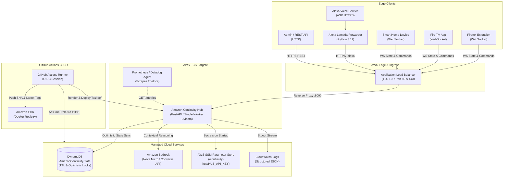

# Amazon Continuity Hub

Real-time cross-device state synchronization and event-routing mesh unifying Alexa, Fire TV, Firefox, and smart-home devices under one user context.



## Quickstart

```bash
make venv
source .venv/bin/activate
make install
cp .env.example .env
make run &
make sim
```

## Environment Variables

| Variable | Type | Default | Description |
|---|---|---|---|
| `USE_AWS` | bool | `false` | `false` for offline in-memory store + mock AI; `true` for DynamoDB + Bedrock |
| `AWS_REGION` | string | `us-east-1` | AWS region for DynamoDB and Bedrock Runtime |
| `DYNAMODB_TABLE` | string | `AmazonContinuityState` | DynamoDB table name for unified user state persistence |
| `BEDROCK_MODEL_ID` | string | `us.amazon.nova-micro-v1:0` | Bedrock model ID or inference profile (alternative: `anthropic.claude-3-haiku-20240307-v1:0`) |
| `HUB_API_KEY` | string | `""` | Optional API Key (`X-API-Key` header or `api_key` query param); auth disabled if empty |
| `DEFAULT_USER_ID` | string | `default-user` | Fallback user ID when neither `X-User-Id` header nor Alexa session user is provided |
| `CORS_ORIGINS` | JSON list | `["*"]` | Allowed CORS origins; add `moz-extension://<uuid>` for Firefox extension |
| `LOG_LEVEL` | string | `INFO` | Logging level (`DEBUG`, `INFO`, `WARNING`, `ERROR`) formatted as structured JSON |
| `STATE_TTL_DAYS` | integer | `7` | DynamoDB time-to-live expiration period in days |
| `ACTIVE_CONTEXT_MAX_AGE_SECONDS` | integer | `1800` | Freshness TTL for active continuity context (default: 30 minutes) |
| `HEARTBEAT_INTERVAL_SECONDS` | integer | `20` | Server-side WebSocket heartbeat ping broadcast interval |
| `HEARTBEAT_TIMEOUT_SECONDS` | integer | `60` | Inbound WebSocket inactivity timeout before closing dead sockets |
| `ALEXA_ENFORCE_SIGNATURE` | bool | `false` | Enforce Amazon ASK RSA-SHA1 signature and X.509 cert verification |

## WebSocket Envelope Contract & Heartbeat

All device communication uses standardized JSON envelopes:

```json
{
  "type": "state_update",
  "id": "7b8d4e51-419a-4c22-bca4-d4ef4bcae310",
  "source_device_id": "firefox-mac",
  "target_device_id": null,
  "ts": "2026-10-23T17:00:00.000000+00:00",
  "payload": {
    "device_type": "firefox",
    "tabs": [
      {
        "title": "Prime Video - The Expanse",
        "url": "https://video.amazon.com/watch?v=123",
        "active": true,
        "media_position_seconds": 754.0
      }
    ]
  }
}
```

Envelope types supported: `snapshot`, `state_update`, `command`, `presence`, `ping`, `pong`, `ack`, and `error`.

### Heartbeat Contract
Clients MUST reply to `ping` with `pong` within `HEARTBEAT_TIMEOUT_SECONDS`; any inbound message refreshes liveness. Idle devices that never reply are disconnected.

## Observability: `/metrics` vs `/stats`

- **`GET /metrics`**: Standard Prometheus text exposition (`CONTENT_TYPE_LATEST`). Exposes Prometheus metrics:
  - `hub_events_routed_total` (Counter)
  - `hub_alexa_requests_total` (Counter)
  - `hub_store_writes_degraded_total` (Counter: unconditional DynamoDB fallbacks)
  - `hub_bedrock_calls_total` (Counter)
  - `hub_bedrock_fallbacks_total` (Counter)
  - `hub_ws_connections` (Gauge: real-time live connection count)
  - `hub_alexa_latency_seconds` (Histogram: request durations with buckets from 0.05s to 8.0s)
- **`GET /stats`**: JSON dictionary for legacy dashboards and quick inspections (`ws_connections`, `events_routed`, `alexa_requests`, `bedrock_calls`, `bedrock_fallbacks`, `avg_alexa_latency_ms`).

## CORS & Browser Extension Support

When `CORS_ORIGINS == ["*"]` (wildcard), `allow_credentials=False` is set to adhere strictly to the CORS specification. To connect the Firefox browser extension with credentials, add its UUID to `.env`:
```json
CORS_ORIGINS=["moz-extension://a1b2c3d4-e5f6-7890-abcd-ef1234567890", "http://localhost:3000"]
```

## Alexa Request Verification & Production Checklist

Set `ALEXA_ENFORCE_SIGNATURE=true` in production to cryptographically verify inbound ASK requests before parsing:
1. Validates presence of `Signature` and `SignatureCertChainUrl` headers.
2. Validates cert URL scheme is HTTPS, host is `s3.amazonaws.com`, port 443, and path starts with `/echo.api/`.
3. Downloads X.509 certificate with a 5-second timeout, caches in-memory for 1 hour, and checks validity period.
4. Verifies Subject Alternative Name (SAN) includes `echo-api.amazonaws.com`.
5. Verifies RSA-SHA1 signature over the raw request body.
6. Rejects requests whose body `timestamp` differs from server time by more than 150 seconds.

## Single-Worker Container Architecture

The Docker container and `docker-compose.yml` run a single Uvicorn worker process (`--workers 1`) by design. Because client WebSocket connection registries (`ConnectionManager`) and in-memory caches reside in process memory, horizontal scaling requires either an external pub/sub layer (such as Redis or Amazon SNS/SQS) or ALB sticky sessions. For deterministic state coherence and zero synchronization lag, the service runs as a single-worker container.

## Security Considerations

1. **API Key Authentication**: `HUB_API_KEY` may be sent via `X-API-Key` header or `api_key` query parameter. The query parameter exists for constrained browser WebSocket APIs and should be treated as best-effort; header authentication is preferred for all REST operations.
2. **Least-Privilege IAM**: The ECS task execution role and task runtime role are strictly separated. The task role is granted access only to the specific DynamoDB table ARN, Bedrock foundation models, and the SSM Parameter Store secret.
3. **Secrets Management**: Sensitive credentials like `HUB_API_KEY` are stored in AWS Systems Manager Parameter Store as `SecureString` and injected into the task definition at runtime.
4. **Transport Layer Security**: In production, all external traffic is terminated via TLS 1.3 on the Application Load Balancer using ACM certificates.

## Infrastructure as Code & CD Deployment

Terraform templates are provided under `infra/` to provision:
- Amazon DynamoDB on-demand table with TTL and PITR
- Amazon ECR repository with scan-on-push and lifecycle rules
- Application Load Balancer with health checks on `/health` (10s interval)
- Amazon ECS cluster and Fargate service with circuit-breaker rollback enabled

### CD Deployment Flow
1. Push to `main` triggers `.github/workflows/deploy.yml`.
2. Runner assumes an AWS IAM role via OpenID Connect (OIDC).
3. Docker image is built and pushed to ECR tagged with `${{ github.sha }}` and `latest`.
4. Task definition is rendered and deployed to ECS with `--wait-for-service-stability`.
5. Post-deployment smoke test curls `${ALB_URL}/health`. If the health check fails, `.github/scripts/rollback.sh` deploys the previous task definition revision automatically.
6. Manual rollbacks can be executed anytime via `gh workflow run deploy.yml --field target_revision=<rev>`.

### GitHub OIDC Trust Policy
To configure GitHub Actions OIDC authentication, create an IAM role with the following trust policy:
```json
{
  "Version": "2012-10-17",
  "Statement": [
    {
      "Effect": "Allow",
      "Principal": {
        "Federated": "arn:aws:iam::<ACCOUNT_ID>:oidc-provider/token.actions.githubusercontent.com"
      },
      "Action": "sts:AssumeRoleWithWebIdentity",
      "Condition": {
        "StringEquals": {
          "token.actions.githubusercontent.com:aud": "sts.amazonaws.com"
        },
        "StringLike": {
          "token.actions.githubusercontent.com:sub": "repo:<GITHUB_ORG_OR_USER>/AmazonHackathon:*"
        }
      }
    }
  ]
}
```

## Assumptions

1. **User Identity Mapping**: Requests without an `X-User-Id` header check `session.user.userId` in the Alexa payload, falling back to `DEFAULT_USER_ID`.
2. **Active Context Resolution**: When Firefox publishes an active tab with `media_position_seconds > 0` or Fire TV publishes `now_playing.state == "playing"`, this is set as the active video context. When Fire TV publishes `now_playing.state == "idle"`, `active_context` is invalidated (`None`). When Firefox publishes an active tab without `media_position_seconds`, context is superseded with `page` context at 0.0s.
3. **Freshness Gate**: Active context is validated against `ACTIVE_CONTEXT_MAX_AGE_SECONDS` (1800s). If expired or missing, voice requests respond: *"Nothing is active to continue right now."*
4. **Same-Device Reconnect Race**: When a client reconnects with the same `user_id` and `device_id`, the previous socket is replaced. The previous socket's cleanup handler checks whether it is still the currently registered socket before modifying state or broadcasting offline presence.
5. **DynamoDB Optimistic Concurrency**: The state store performs 4 retries with exponential backoff (`0.05 * 2^attempt`) upon `ConditionalCheckFailedException`. If all retries are exhausted, it executes an unconditional last-writer-wins put, logs a warning with event `dynamo_conflict_unconditional`, and increments `hub_store_writes_degraded_total`.
6. **Voice Constraints**: Alexa responses are strictly formatted to under 300 plain-text characters without SSML or markdown to avoid TTS errors.
7. **Bedrock Timeout & Fallbacks**: Bedrock Converse calls are executed inside `asyncio.to_thread` with a 4.5-second deadline; on timeout, error, or empty response, the hub falls back to the rule-based engine with `degraded=True`.
